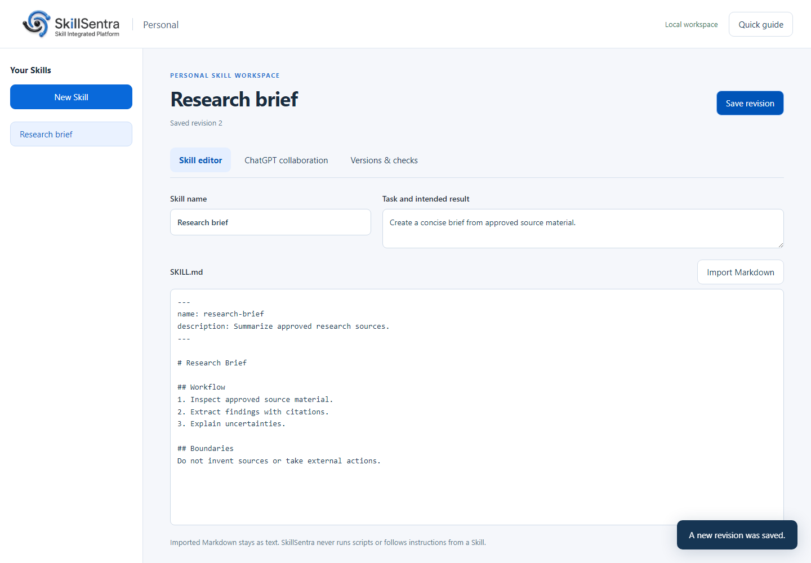

# SkillSentra Personal

A local workspace for individuals who create and improve Agent Skills with ChatGPT.

**Version:** 0.7.0-personal.1 · **Public branch:** `main` · **Status:** Developer Preview



## What it does

- Create a Skill from a starter or import a single `SKILL.md` file.
- Edit Markdown and keep a local revision history.
- Prepare a context-bound prompt for your own ChatGPT conversation.
- Import ChatGPT's JSON response, inspect the diff and explicitly accept changes.
- Reject stale responses after the saved project changes.
- Run static structure checks and export a Skill ZIP.
- Restore earlier content without erasing later history.

ChatGPT collaboration is a manual exchange. Opening ChatGPT does not upload content. SkillSentra makes no external requests, invokes no model API and does not verify who authored a pasted response. You choose what to share and what to apply.

## Run locally

Install Python 3.11 or newer. From this folder:

```sh
python -m app.server
```

Open [http://127.0.0.1:8767](http://127.0.0.1:8767). No account, API key or runtime package installation is required. The server binds only to the loopback address.

```sh
python -m app.server --port 8768 --data ./data/another-personal.db
```

Keep the original 0.6.7 app and its database separate. Personal Edition starts with an empty database and does not migrate the old platform's data.

## First use

1. Select **Create your first Skill** and describe your task.
2. Replace the starter placeholders and select **Save revision**.
3. Open **ChatGPT collaboration** and select **Prepare ChatGPT request**.
4. Copy the prompt, open your own ChatGPT conversation and paste it there.
5. Paste its JSON response back. Select **Review response** and inspect the full proposed Skill.
6. Confirm and apply, then open **Versions & checks** and export.

See the [user guide](docs/USER_GUIDE.md), [ChatGPT exchange format](docs/CHATGPT_COLLABORATION.md) and [English introduction PDF](docs/SkillSentra-Personal-Introduction.pdf).

## Personal Edition scope

The current branch removes marketplace, ranking, purchases, payment collection, settlement, team accounts, registration, control-plane administration and direct model API configuration. It uses a dedicated service and a three-table local database. The original platform remains in a private local `baseline/0.6.7` branch and is not included in this public repository.

This is a focused replacement of the platform workflow, not a feature-identical upgrade. Multi-file Skill imports, scripted execution, automatic host callbacks and the old nine-step/seven-step workflows are outside this edition. [Edition comparison](docs/EDITION_SCOPE.md).

## Data and privacy

Projects, revisions and collaboration requests live in `data/personal.db`. No telemetry or background discovery runs. Imported content is text and is never executed. ChatGPT receives content only when you share it yourself, under the terms of your own ChatGPT account.

Stop the server before copying the complete data directory for backup. Deletion removes current project records but is not a secure erase of backups or storage media.

## Development

```sh
python -m unittest discover -s tests -v
npm ci
npx playwright install chromium
npm run test:browser
```

Python is the only runtime dependency. Node and Playwright are development tools. See [architecture](docs/ARCHITECTURE.md), [validation](docs/VALIDATION.md), [contribution guide](CONTRIBUTING.md) and [security policy](SECURITY.md).

## License

Personal non-commercial use is free under the inherited custom source-available license. Removing billing features does not replace the license with an open-source license or waive the existing commercial terms. Freelancing remains commercial use. See [LICENSE](LICENSE) and [licensing notes](docs/LICENSING.md).

Public repository: [AIfromScratch66/SkillSentra-Personal](https://github.com/AIfromScratch66/SkillSentra-Personal). This is a Developer Preview. Independent ownership, brand-asset and security reviews have not been completed.
